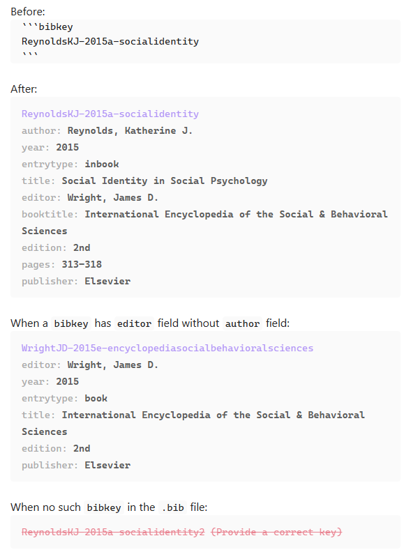
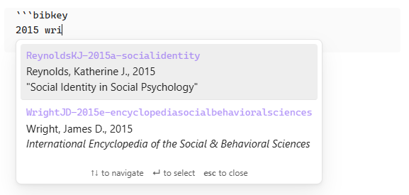
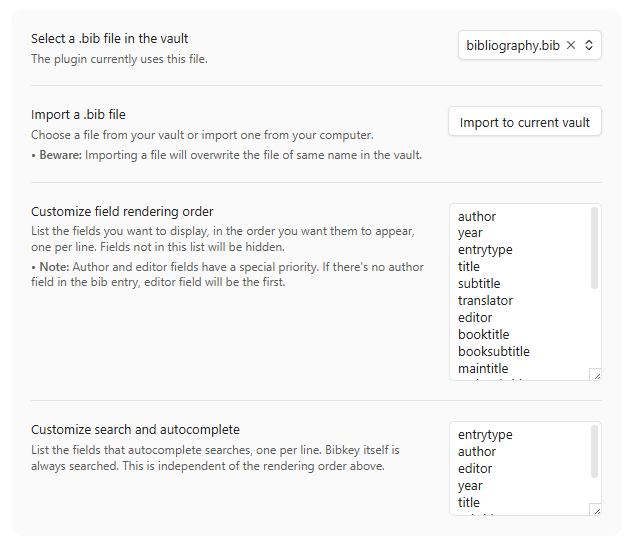

# bibtex entry view, a plugin for obsidian

## requirements

- Obsidian 1.13 or later.
- Desktop only.

## what it carries out

### renders `bibkey` codeblock


- If the plugin finds the `bibkey` in the `.bib` file, the codeblock (first codeblock above) is replaced with the entry view of the `bibkey` (second codeblock).
- If the plugin cannot render the entry, the codeblock is rendered in red colored text and strikethrough (fourth codeblock), with the reason:
  - `(Provide a correct key)`: the codeblock is empty, or the `bibkey` is not in the `.bib` file.
  - `(No bib file selected)`: no `.bib` file is chosen in the `settings`. (v. 0.2.5)
  - `(Bib file not found: {path})`: the chosen `.bib` file is missing, e.g. renamed or deleted. (v. 0.2.5)

### suggests the match



- Suggested list will be shown while typing `{bibkey}` as shown above. (v. 0.2.0)
- Each keyword should be at least two letters long.
- Separate keywords with spaces. An entry matches when every keyword is part of a word in the entry, e.g. `rey 2015`.
- The keywords are matched against the `bibkey` and the fields in `Customize search and autocomplete` in the `settings`. (v. 0.2.5)
  - By default: `author`, `editor`, `year`, `title`, `subtitle`.
  - This is independent of the rendering order, so a field hidden from the codeblock can still be searched.
- Each suggestion shows the `bibkey`, the author (or editor) and year, and the title. A long author list is cut with `…`, but the year always stays visible. (v. 0.2.5)

### What's in the `.bib` file which is generated by `jabref`.
```bibtex
@InBook{ReynoldsKJ-2015a-socialidentity,
  author           = {Reynolds, Katherine J.},
  booktitle        = {International Encyclopedia of the Social & Behavioral Sciences},
  citationkey      = {ReynoldsKJ-2015a-socialidentity},
  edition          = {2nd},
  editor           = {James D. Wright},
  pages            = {313--318},
  publisher        = {Elsevier},
  title            = {Social Identity in Social Psychology},
  year             = {2015},
  abstract         = { ... },
  creationdate     = {2024-07-22T13:12:48},
  doi              = {10.1016/B978-0-08-097086-8.24064-6},
  modificationdate = {2025-06-23T21:48:18},
}

@Book{WrightJD-2015e-encyclopediasocialbehavioralsciences,
  citationkey      = {WrightJD-2015e-encyclopediasocialbehavioralsciences},
  edition          = {2nd},
  editor           = {James D. Wright},
  publisher        = {Elsevier},
  title            = {International Encyclopedia of the Social & Behavioral Sciences},
  year             = {2015},
  creationdate     = {2025-06-23T18:01:38},
  modificationdate = {2025-06-23T21:48:59},
}
```

## what the plugin renders in the codeblock

- In the first line,
  - it shows the `bibkey` in the accent color of obsidian.
- In the second line,
  - If the Bibtex entry has `author` field, it shows the author field name and its value right after the `bibkey`.
  - If the Bibtex entry does not have `author` field but an `editor` field, it shows the editor field name and its value right after the `bibkey`.
  - All kinds of name are in "von last, jr, first" format, e.g. `van Beethoven, Ludwig`, `King, Jr., Martin Luther`. Parts a name does not have are left out, e.g. `Reynolds, Katherine J.`. (v. 0.2.5)
- In the third line and so on,
  - it sorts all the other field names and their values by the order of `Customize field rendering order` in the `settings` and shows them.
  - Fields not in that list are hidden.

## so, how a user can use it

### before using it

- Put the `.bib` file anywhere in the vault.
- Or, import one in the settings. It is saved in the root of the vault.
- Or, make a symbolic link to user's own `.bib` file in the vault.

### `settings` tab example



### choose a `.bib` file in the current vault

- Initially, no `.bib` file is selected.
- A user needs to choose the `.bib` file or the symbolic link in the vault.

### Or, import a `.bib` file from outside the vault into the vault.
  - If a file with the same name is already in the vault, the plugin asks before overwriting it. (v. 0.2.5)

### customize rendering

- A user can choose fields and their order to render, one per line.
- Changes are applied to open notes right away.

### customize search (0.2.5)

- A user can choose fields to include in search, one per line.
- The `bibkey` is always searched. `entrytype` can be added to search by entry type, e.g. `book`.

### in a note

- Write a codeblock in the following format

````
```bibkey
{bibkey}
```
````

- Or, type ```` ```bibkey ```` followed by a space and keywords on one line. When a suggestion is chosen, it is rewritten into the format above. (v. 0.2.5)

## known bug or malfunctioning

- It seems that the plugin does not show suggestions irregularly when using a plugin `Various Complements`. Looking into this problem. (@ v. 0.2.0)

## what is planned to add next

- adding a command to manually update the entry indices when updating the target `.bib` file of the symbolic link.
- fuzzy search for autocompletion suggestion

## support

- If you like this project, please support. 

[](https://ko-fi.com/kydem)

## license

MIT
